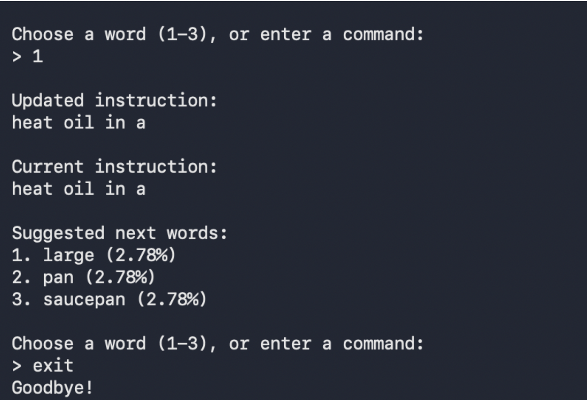
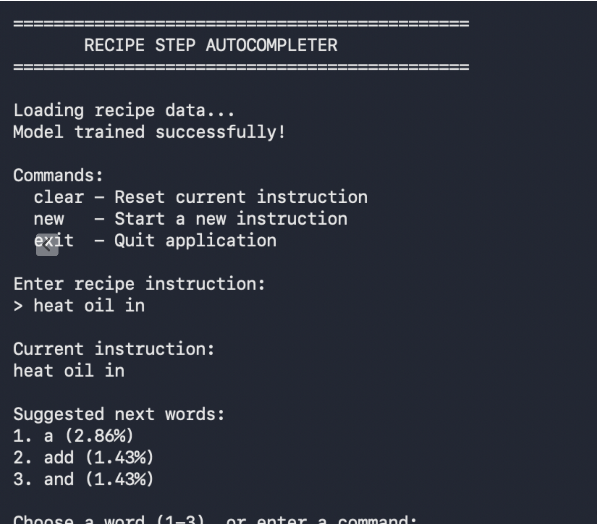

# Recipe Step Autocompleter

A Python-based Natural Language Processing (NLP) project that predicts and suggests the next word in an incomplete cooking instruction using statistical language models.

The application uses Unigram, Bigram and Trigram models with Maximum Likelihood Estimation (MLE), Laplace smoothing and a backoff strategy to generate next-word suggestions through an interactive command-line interface.

## Features

* Recipe instruction preprocessing and tokenization.
* Unigram, Bigram and Trigram language models.
* Maximum Likelihood Estimation (MLE).
* Laplace smoothing to handle unseen n-grams.
* Trigram-to-Bigram-to-Unigram backoff prediction.
* Ranked next-word suggestions.
* Interactive CLI with suggestion selection.
* Recipe-aware evaluation using Leave-One-Recipe-Out Cross-Validation.
* Evaluation metrics including Top-1 accuracy, Top-3 accuracy, perplexity and vocabulary coverage.
* JSON-based key-value storage utility.
* Optional LLM API integration supporting compatible Ollama, Groq and Gemini endpoints.

## How It Works

The application follows a statistical NLP pipeline.

1. Text Preprocessing

Recipe instructions are converted into lowercase tokens.

Example:

Input:

Heat oil in a pan.

Tokens:

["heat", "oil", "in", "a", "pan"]

2. N-gram Language Models

The application builds three language models:

Unigram: Calculates individual word frequencies.

Bigram: Calculates the probability of a word based on the preceding word.

Trigram: Calculates the probability of a word based on the preceding two words.

3. Probability Estimation

Maximum Likelihood Estimation is used to calculate conditional probabilities.

Laplace smoothing is applied to avoid zero probabilities for unseen word combinations.

Bigram probability:

P(w2 | w1) = (Count(w1, w2) + α) / (Count(w1) + αV)

Trigram probability:

P(w3 | w1, w2) = (Count(w1, w2, w3) + α) / (Count(w1, w2) + αV)

Where:

* α represents the smoothing parameter.
* V represents vocabulary size.

4. Backoff Prediction

The prediction system follows this hierarchy:

1. Trigram model: Uses the previous two words.
2. Bigram model: Falls back to the previous word.
3. Unigram model: Uses overall word frequencies when contextual information is unavailable.

The application ranks predictions by probability and returns the most likely next words.

5. Interactive CLI

Users enter an incomplete cooking instruction and receive three suggested next words.

They can select a suggestion to extend the current instruction.

Available commands:

* clear — Reset the current instruction.
* new — Start a new instruction.
* exit — Close the application.

## Project Structure

recipe-step-autocompleter/
│
├── app/
│   ├── __init__.py
│   ├── core.py
│   ├── cli.py
│   ├── evaluation.py
│   ├── llm.py
│   └── storage.py
│
├── data/
│   └── recipes.txt
│
├── tests/
│   ├── test_core.py
│   ├── test_cli.py
│   ├── test_evaluation.py
│   └── test_smoke.py
│
├── .env.example
├── .gitignore
├── pytest.ini
├── requirements.txt
└── README.md

## Installation

### Requirements

* Python 3.12
* pip
* Git

1. Clone the repository

git clone https://github.com/Sanskarmetri/-recipe-step-autocompleter.git
cd recipe-step-autocompleter

2. Create a virtual environment

python3.12 -m venv .venv

Activate it:

macOS/Linux:

source .venv/bin/activate

Windows:

.venv\Scripts\activate

3. Install dependencies

pip install -r requirements.txt

4. Configure environment variables

cp .env.example .env

The statistical autocomplete model works locally without an API key.

The optional LLM utility can be configured using an OpenAI-compatible endpoint.

Supported configurations include:

* Ollama
* Groq
* Gemini

Refer to .env.example for configuration examples.

## Usage

Verify installation

python -m app.cli hello

Start the autocomplete application

python -m app.cli autocomplete

Enter an incomplete recipe instruction and select one of the suggested words.

Run automated tests

pytest -v

## Sample Execution

The following example demonstrates the interactive
command-line autocomplete system.

### Example 1

Input:

    heat oil in

Suggested next words:

    1. a (2.86%)
    2. add (1.43%)
    3. and (1.43%)

After selecting option 1:

    Updated instruction:
    heat oil in a

### Example 2

The system generates new suggestions using the updated context.

Input:

    heat oil in a

Suggested next words:

    1. large (2.78%)
    2. pan (2.78%)
    3. saucepan (2.78%)

Users can select a suggestion to continue extending
their cooking instructions.
## Application Screenshots

### Initial Suggestions

### Interactive Word Selection

## Model Evaluation

The model is evaluated using Leave-One-Recipe-Out
Cross-Validation (LORO-CV).

One complete recipe is held out for testing while the
remaining recipes are used for training. This preserves
recipe boundaries between training and testing.

### Evaluation Metrics

| Metric | Description |
|---|---|
| Top-1 Accuracy | Percentage of correct first suggestions. |
| Top-3 Accuracy | Percentage of correct targets among the first three suggestions. |
| Perplexity | Measures uncertainty in probability predictions. |
| Vocabulary Coverage | Percentage of target tokens present in training vocabulary. |
| OOV Tokens | Target tokens absent from training vocabulary. |

### Experimental Results

Results obtained using the current recipe dataset:

| Metric | Result |
|---|---:|
| Evaluated Tokens | 55 |
| Skipped OOV Tokens | 47 |
| Vocabulary Coverage | 53.92% |
| Top-1 Accuracy | 32.73% |
| Top-3 Accuracy | 45.45% |
| Unigram Baseline Accuracy | 0.00% |
| Bigram Baseline Accuracy | 32.73% |
| Perplexity | 34.05 |

### Limitations

- The current dataset contains only three recipes.
- Vocabulary coverage is limited.
- The trigram model does not outperform the bigram baseline.
- Results are preliminary and cannot establish strong generalization.
- A larger and more diverse dataset is required.

### Run Evaluation

    python -m app.evaluation

## Testing

The project includes automated tests covering:

- Text preprocessing.
- N-gram counting.
- Probability calculations.
- Backoff prediction.
- Probability normalization.
- CLI interactions.
- Suggestion selection.
- Recipe boundary preservation.
- Evaluation metrics.
- Out-of-vocabulary handling.
- Application smoke tests.

Run the tests using:

    pytest -v

## Future Improvements

- Expand the recipe dataset.
- Improve vocabulary coverage.
- Experiment with higher-order n-gram models.
- Introduce phrase-level prediction.
- Compare statistical models with neural language models.
- Improve contextual understanding.
- Develop a graphical user interface.
- Integrate the optional LLM utility into the autocomplete workflow.

## Technologies Used

- Python
- Natural Language Processing
- Statistical Language Modeling
- N-gram Models
- Maximum Likelihood Estimation
- Laplace Smoothing
- Pytest
- JSON
- HTTPX

## License

Add an appropriate open-source license before distributing the project.
